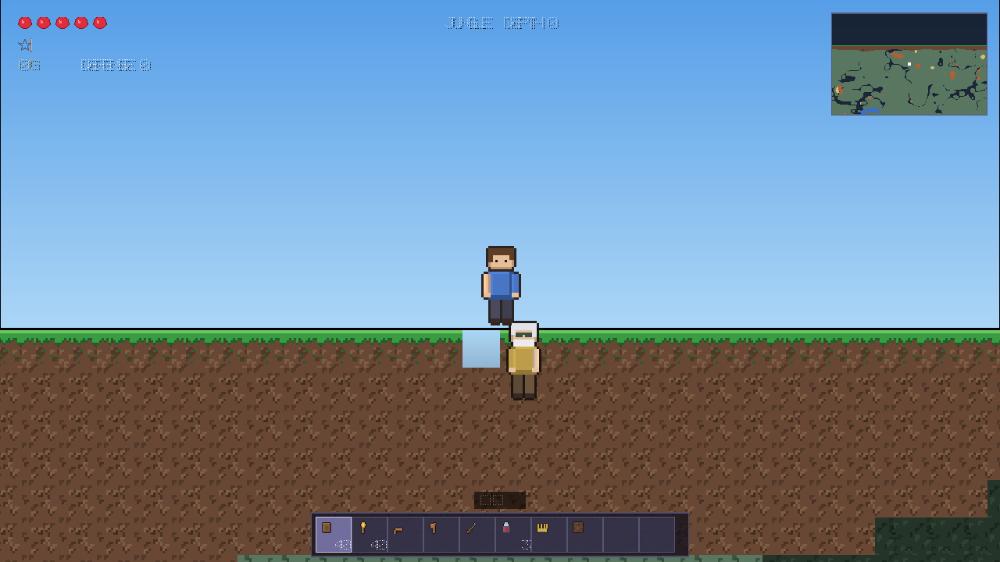
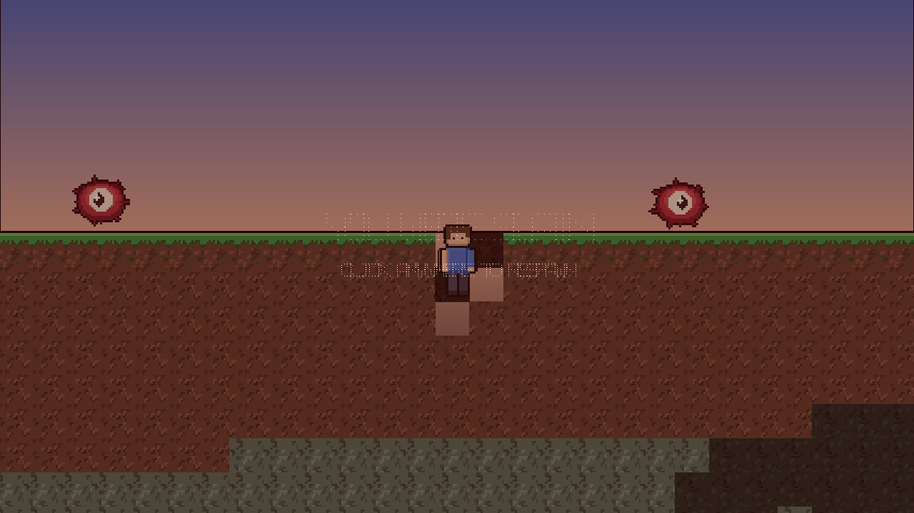
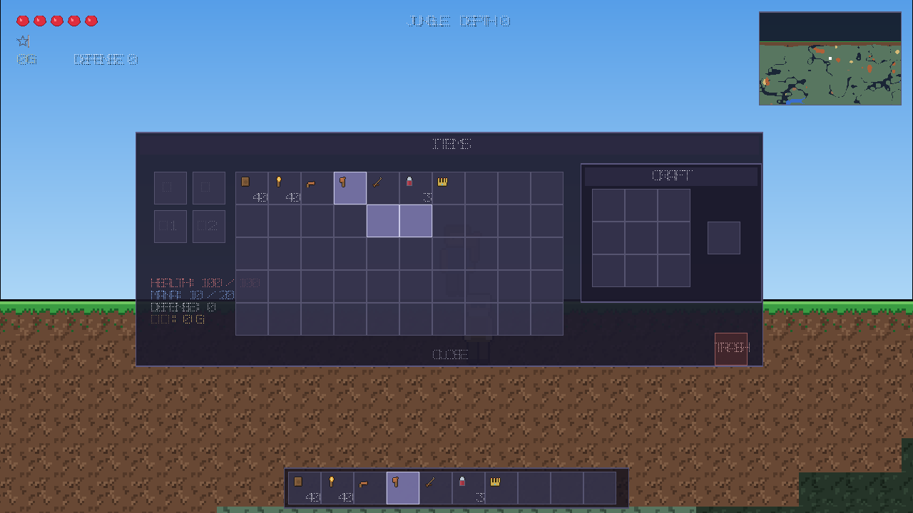
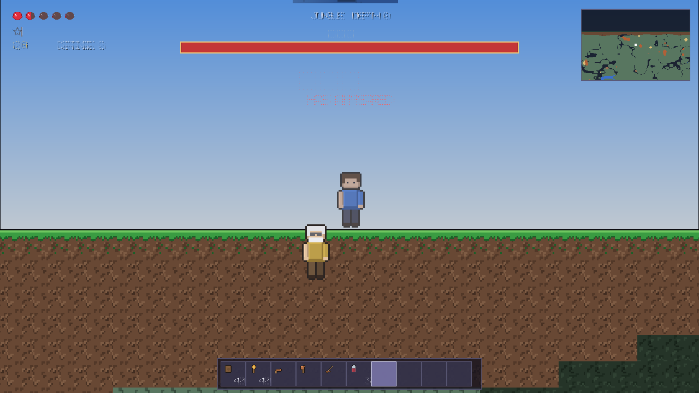
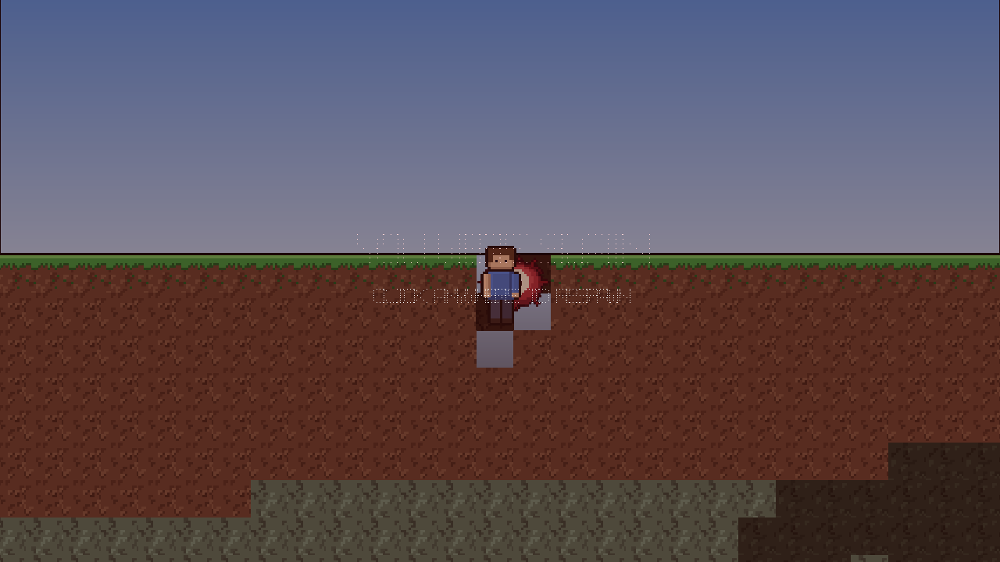
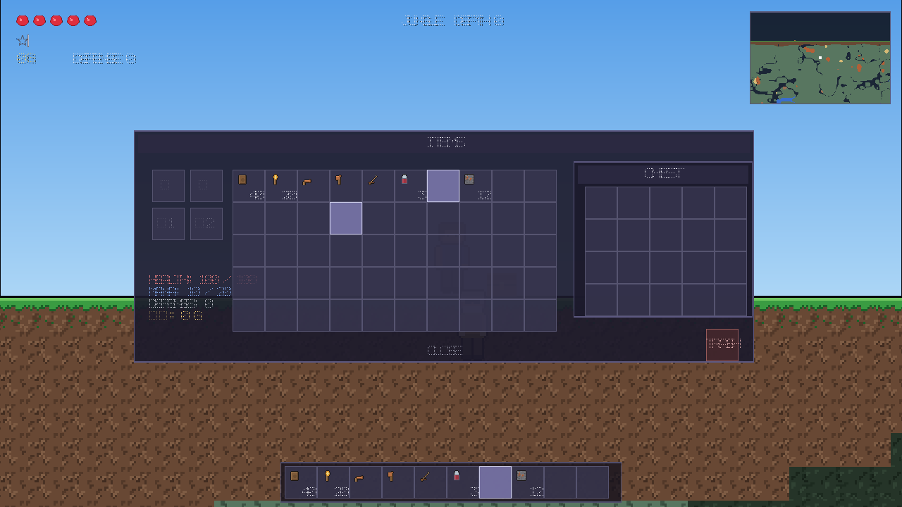

# 泰拉瑞亚复刻（Terraria Clone）

用 **C++17 + raylib** 从零实现的 2D 沙盒游戏：挖矿、建造、合成、战斗、打 Boss、探地牢。
横向无限、区块流式生成的地形，配合昼夜循环、光照传播、多生物群系与地下矿脉。

> 这是个人 C/C++ 学习项目合集里的一款小游戏，代码从零手写，美术素材由脚本程序化生成。



| | |
|---|---|
|  |  |
| 挖掘与掉落物 | 背包 / 装备 / 合成界面 |
|  |  |
| 史莱姆王 Boss 战 | 入夜的恶魔之眼 |

箱子存取界面（右键箱子打开）：



---

## ✨ 已实现功能

### 世界
- **区块流式生成**：64×64 为一块，随玩家移动按需生成 / 回收（每帧限量生成，避免卡顿）
- **无限横向世界**：地形由 `fbm` 值噪声决定，同一个种子任何时候进入都是同一个世界
- **8 种生物群系**：森林、沙漠、雪原、丛林、腐化之地、海洋、洞穴、地狱
- **地表植被**：橡树 / 雪松 / 丛林高树 / 仙人掌 / 枯树 / 腐化裂隙 / 丛林藤蔓
- **地下**：天然洞穴 + 大型洞厅、按深度分布的矿脉（铜/铁/银/金/陨石/狱石 + 4 种宝石）、黏土层、荧石洞
- **地狱层**：底部岩浆海、狱石与黑曜石
- **光照传播**：天空光自上而下灌入 + BFS 扩散，火把/荧石/岩浆/篝火等自发光方块，昼夜变化时天空光等级联动重算
- **背景墙**：每种地表/地下层对应不同墙体，挖掉方块后能看到墙，营造洞穴纵深

### 沙盒循环
- 挖掘：按住左键，按方块硬度 / 镐等级 / 工具速度计算耗时，带裂纹进度贴图
- 建造：右键放置方块与家具，会检测是否挡住玩家或怪物
- 50 格背包（10 快捷栏 + 40 储物）、堆叠、装备栏（头盔 / 护甲 / 饰品 ×2）
- 合成：背包内 2×2、工作台 3×3、铁砧；熔炉冶炼矿石与沙子
- **流体模拟**：水按存量（0-255）逐格计算，会下落、在坑里积成水柱、填方块时向上溢出；只有被扰动的格子才进入模拟队列，整片海洋不会消耗性能
- 掉落物会被玩家吸附拾取，箱子可存放 20 格物品
- 存档：区块 RLE 压缩 + 玩家状态，`save/world.wld` 二进制存档

### 战斗
- 剑：挥砍扇形判定、暴击、击退、伤害飘字、火花/血液粒子
- 弓：按住左键蓄力，松手射出带重力的箭
- 魔法珠：消耗魔力，三发扇形弹幕
- 药水：治疗 / 魔力，脱战自动回血
- 装备加成：伤害、攻速、暴击、防御、移速、跳跃高度、生命/魔力上限

### 敌人与 Boss
| 敌人 | 特点 |
|---|---|
| 蓝/绿/紫史莱姆 | 跳跃追击，四种颜色对应不同强度与掉落 |
| 僵尸 | 地面行走，会跳过障碍，掉落骨头与绳索 |
| 恶魔之眼 | 飞行，周期性冲刺，掉落透镜 |
| **史莱姆王** | 2000 血，蓄力后大跳，会召唤小史莱姆，掉落大量凝胶与金币 |
| **克苏鲁之眼** | 2800 血，半血进入二阶段（换贴图 + 高速冲刺 + 召唤仆从），掉落陨石矿与透镜 |

- 按昼夜自动刷怪（白天地表安全、夜晚危险），地下越深越危险
- NPC：**向导**（世界出生点）、**商人**（检测到合法房屋后入住，可购买补给，商店右键售卖）

### 音效
- 21 个程序化合成的音效（挖掘/破坏/放置/跳跃/落地/受伤/拾取/合成/开箱/命中/击杀/金币/Boss 登场/入水/脚步/挥剑…）
- 挖掘音按方块材质分三种（泥土 / 木材 / 石头）并带随机音高，脚步按地面材质变调，重复触发带节流
- 素材是真实的 16bit WAV 文件，直接用同名文件覆盖即可换成自己的音效；整个 `assets/sfx/` 删掉则自动静音

### 界面
- 生命爱心 / 魔力星星 / 金币 / 防御 / 生物群系 / 深度
- 快捷栏、物品名称提示、物品属性悬浮说明
- 背包 + 装备 + 合成 + 熔炉 + 垃圾箱
- 右上角实时小地图、Boss 血条、拾取与提示消息
- 暂停菜单（继续 / 保存 / 读取 / 退出）、死亡界面

---

## 🎮 操作

| 按键 | 功能 |
|---|---|
| `A` `D` / `←` `→` | 左右移动 |
| `空格` | 跳跃（水中为上浮，可按住） |
| `S` / `↓` | 从平台上下落 |
| `鼠标左键` | 挖掘方块 / 攻击 / 蓄力射箭 |
| `鼠标右键` | 放置方块 / 使用物品 / 开关门 / 与 NPC 交谈 |
| `1` ~ `0`、滚轮 | 切换快捷栏 |
| `E` | 打开/关闭背包 |
| `ESC` | 暂停菜单（再次按下关闭） |
| `F5` / `F9` | 快速保存 / 读取 |

**上手流程**：先砍树造木板 → 做工作台（9 木头）→ 铜镐（6 铜锭）→ 挖石头做熔炉 →
熔铜锭做铜剑 → 往下挖找铁矿 → 夜幕前用土墙搭个房子并点篝火 → 攒够凝胶做**史莱姆王冠**打第一个 Boss。

---

## 🛠 环境要求与运行

- Visual Studio 2022（v143 工具集），平台选 **x64**
- 依赖 [raylib](https://www.raylib.com/)

**第 1 步：装 raylib（两条路都行）**

| 方式 | 做法 |
|---|---|
| A. 一键脚本（推荐） | 双击项目根目录的 **`setup_raylib.bat`**，自动从 raylib 官方发布页下载预编译包并解压到 `lib/`（约 3MB，几秒钟） |
| B. 手动 | 从 [raylib 发布页](https://github.com/raysan5/raylib/releases) 下载 `raylib-5.5_win64_msvc16.zip`，把 `include/` 和 `lib/` 两个文件夹复制到项目的 `lib/` 目录 |

> 工程**没有使用 vcpkg 清单模式**。VS 自带的 vcpkg 要求清单里必须写 `builtin-baseline`，
> 会报「此 vcpkg 实例需要具有指定基线的清单才能与端口交互」——所以这里直接用官方预编译包，
> 少一层依赖，也不用现编 raylib。详见 `lib/README.md`。

**第 2 步：编译运行**

1. 用 Visual Studio 打开 `Project1.sln`
2. 选择 `Debug | x64`
3. 生成并运行（F5）。工作目录应为项目根目录（`assets/` 和存档都在根下）

**常见问题**

| 报错 | 解决 |
|---|---|
| `无法打开包括文件: "raylib.h"` | raylib 没装上，回到第 1 步 |
| `无法打开输入文件: "raylib.lib"` | 确认平台是 **x64** 而不是 Win32 |
| 运行时缺 `raylib.dll` | 把 `lib\lib\raylib.dll` 复制到 exe 同目录 |
| 运行报找不到 `assets` | 把工作目录改成 `$(ProjectDir)` |
| 界面中文变成方块 | 系统里没找到中文字体，见下面的「素材说明」 |

---

## 📁 目录结构

```
泰拉瑞亚复刻/
├── Project1.sln / Project1.vcxproj   Visual Studio 工程
├── setup_raylib.bat                 一键下载 raylib 官方预编译包
├── lib/                              raylib 头文件与库(脚本自动放好, 见 lib/README.md)
├── assets/                           美术与音效素材（由脚本生成）
│   ├── tiles.png / items.png         方块图集 / 物品图标图集
│   ├── entities.png / gui.png        角色精灵 / 界面图标
│   └── atlas.txt                     图集清单：<文件> <名字> <x> <y> <w> <h>
├── tools/
│   ├── gen_assets.py                 像素素材生成器（Pillow）
│   └── gen_sfx.py                    程序化音效合成器（纯 Python，输出 WAV）
├── screenshots/                      README 配图
└── src/
    ├── main.cpp                      入口：初始化 / 主循环
    ├── Common.h                      全局常量与工具函数
    ├── Audio.h/.cpp                  音效系统：载入 / 节流 / 音量
    ├── Noise.h                       哈希与值噪声 / fbm
    ├── Assets.h/.cpp                 图集加载、按名字取帧、中文字体
    ├── Text.h/.cpp                   中英双语案与字体字符集收集
    ├── Tiles.h/.cpp                  方块与背景墙定义表
    ├── Items.h/.cpp                  物品表与合成配方表
    ├── World.h/.cpp                  区块存取 / 地形生成 / 光照传播 / 流体模拟
    ├── Player.h/.cpp                 玩家：移动 / 挖掘 / 建造 / 战斗
    ├── Entities.h/.cpp               敌人 / Boss / NPC / 弹幕 / 掉落物 AI
    ├── Particles.h/.cpp              粒子系统
    ├── UI.h/.cpp                     全部界面
    └── Game.h/.cpp                   主控：更新流程 / 绘制管线 / 存档
```

---

## 🧩 系统设计要点

**渲染管线**（`Game::draw`）

```
BeginMode2D(相机)
  → 天空渐变 + 太阳/月亮/星星/云
  → 背景墙（按光照着色）
  → 方块（含液体、挖掘裂纹）
  → 实体 / 玩家 / 粒子 / 伤害数字
EndMode2D
  → HUD / 小地图 / 背包 / Boss 血条 / 菜单
```

**光照**：每个区块存一张 15 级灰度图。生成区块时在其四周扩张 18 格区域内做一次
「天空光竖直灌注 + 自发光 + BFS 扩散」，半透明方块（树叶/玻璃/水）额外衰减 1 级。
绘制时对光照做双线性插值，昼夜变化只改天空光等级（整数级，变化时排队重算可见区块）。

**地形生成**：全部由 `(种子, x, y)` 纯函数决定，因此区块可以任意顺序生成而不需要保存中间状态。
树木跨越区块边界时，靠「每个区块都重算左右各 48 列的装饰」保证结果一致。

**流体**：每个区块额外存一张 0-255 的水量图。只有"被扰动"的格子（挖开/填上与水相邻的方块时）
才会进入待更新队列，每帧取一批做「下落 → 摊平 → 唤醒邻居」，处理完立刻从集合中摘除，
这样重新被标记的格子能正确重新入队。横向摊开要求有足够水位差（≥8）且该格已经掉不下去，
避免一格水在平地上永远以 1 单位的速度爬满世界。

**存档**：只保存玩家改动过的区块（`modified` 标记），每层用游程编码压缩。

**贴图查找**：`tiles.png` 与 `items.png` 存在同名帧（dirt/stone/…），因此清单里用
`tile:` / `item:` 前缀区分命名空间，`Assets::FindTile/FindItem` 负责加前缀。

---

## 🎨 素材说明

`assets/` 下所有素材都是脚本生成的，不依赖任何第三方美术资源：

```bash
python3 tools/gen_assets.py   # 方块 / 物品 / 精灵 / UI 图标 -> assets/*.png + atlas.txt
python3 tools/gen_sfx.py      # 21 个音效 -> assets/sfx/*.wav
```

想换成自己的素材：保持 `atlas.txt` 的 `<文件> <名字> <x> <y> <w> <h>` 格式替换即可，
代码无需改动。中文界面会优先加载系统字体（微软雅黑 / 黑体 / 宋体），找不到时自动退回英文文案。

---

## 📌 已知限制

- 流体是"逐格演算"而非原作的压力模型：没有连通性判定，水不会自己找路绕障碍，只做下落 + 摊平 + 溢出
- 门只占 1 格（原作是 2 格高的门框）
- Boss 目前只能用召唤物触发（原版还有夜晚自然出现）
- 还没有背景音乐（音效接口已就位，加一个 `PlayMusicStream` 即可）
- 没有多人联机

---

## 📝 学习笔记

这个项目用来串起 C++ 里的几个点：

- **RAII 与资源管理**：`Chunk` 用 `vector` 持有方块数据，用 `unique_ptr` 管理 `UI`，退出时统一回收
- **数据驱动**：方块、物品、配方全是表驱动的静态数组，逻辑代码不出现魔数
- **组件式实体**：所有敌人共用一个 `Entity` 结构体 + `switch` 分发 AI，而不是一堆子类
- **性能**：区块流式加载 + 每帧生成限量 + 可视范围剔除 + 静态图集缓存 + 光照插值 + 流体只算"脏格子"
- **可测试性**：所有地形/光照/流体都是纯数据接口，不依赖渲染，方便单独验证
